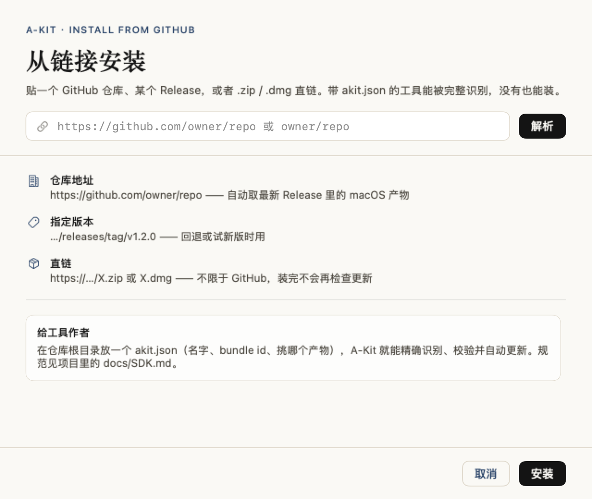
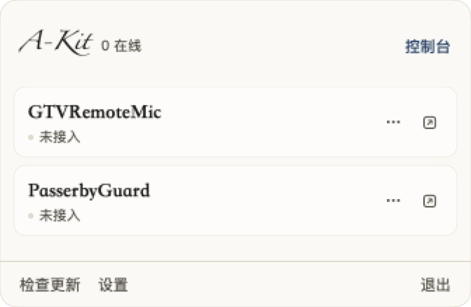

# A-Kit

> 自己写的小工具，自己收着。

一个 macOS 工具控制台：**装 / 更 / 删**一处管完，菜单栏图标收成一个，接入的工具由它统一代管。
还能**贴一个 GitHub 链接就把别人的工具装上**。

这不是要上架的商业软件，是我给自己那堆小工具做的一个「家」。开源，随便看。


---

## 它能干什么

**① 工具管理**
- 清单（远端 manifest）与本机扫描双轨：知道有哪些工具、装没装、装的是哪版
- 安装：下载 → sha256 校验 → 解包 → 校验 bundle id → 落到 `~/Applications` → 去 quarantine
- 更新：目标在跑的时候走「延迟替换」脚本，不用先手动退出
- 卸载：进废纸篓，可选连配置文件一起清
- **版本备份与回滚**：每次覆盖前自动备份，默认留 3 份
- **体检**：签名、Hardened Runtime、Gatekeeper、公证、架构、最低系统版本
- **源码重建 + 热重载**：清单里登记本地源码路径，改完文件约 2 秒自动 rebuild、重启（可选）

**② 从链接安装（GitHub）**



把 `https://github.com/owner/repo`、某个 Release 的地址，或者任意 `.zip` / `.dmg` 直链粘进去：

- 自动问 GitHub 要最新 Release，从一堆产物里挑出 macOS 的那个
- 仓库根目录有 `akit.json` 就精确识别（名字、bundle id、挑哪个包）；没有也能装，靠文件名猜 + 装完读 `Info.plist`
- 装完记住来源，以后能检查更新（tag 变了就把新产物地址换掉）
- 安装前先给你看一张预览卡：版本、产物、大小、有没有自描述、有哪些风险提示

**③ 菜单栏统一**



- 一个图标 → 卡片面板；每张卡上直接放常用开关和实时状态，高级项才进子菜单
- `⌘⇧A` 全局唤起（Carbon 热键，**不需要辅助功能权限**）
- 左键开面板 / 右键出原生菜单，可切换
- 深色模式跟随系统（与博客同一套令牌的深色版本）

**④ 接管是「协作」，不是「劫持」**

```
工具启动
  → 找 ~/Library/Application Support/A-Kit/hub.sock
  → 连上就 register（bundleId / 名字 / 版本 / 菜单结构 / 状态 / 订阅的事件）
  → Hub 代管，工具把自己的 NSStatusItem 藏起来
  → 断开或 Hub 挂了 → 工具 5 秒内把图标挂回去
```

**没装 A-Kit 的工具照常工作**，行为与接入前完全一致。接入只是「多了一个可选的上游」，不是依赖。

**⑤ 事件总线（双向）**
工具可以声明 `subscribes`，也可以主动 `emit`。Hub 按事件名转发，发送者自己不会收到。

```swift
AKHubClient.shared.emit("netpulse.offline", payload: ["since": "9"])
```

**⑥ CLI**

```bash
akit list                       # 所有工具与版本
akit updates                    # 只看有更新的
akit install gtvmic             # 按 id 装
akit install https://github.com/owner/repo   # 按链接装
akit inspect owner/repo         # 只看解析结果，不下载
akit imported                   # 从链接装过的工具
akit doctor                     # 体检所有已装工具
akit export x.json              # 换 Mac 时搬配置
```

---

## 关于「接管第三方图标」

**做不到，也不装做得到。**

macOS 没有公开 API 让 A app 读取、移动、隐藏 B app 的菜单栏图标。Bartender / Ice 那类工具靠「辅助功能」权限模拟点击，或把图标推到屏幕外；macOS 26 起系统自己会插手可见性，所以经常失灵。

A-Kit 的选择：

- 自家 / 已接入的工具 → 走协议，稳定、零权限
- 第三方 → 只在「第三方」页给引导（⌘ 拖动移出菜单栏、系统设置里关），明确写清楚不保证

不申请辅助功能、不申请屏幕录制、不注入、不 swizzle 别人的进程。

---

## 接入自己的工具

完整文档：[`docs/SDK.md`](docs/SDK.md)。单文件 SDK 在 [`SDK/`](SDK/)，核心就三段：

```swift
import AKitStatusKit

AKHubClient.shared.onConnectionChange = { connected in
    statusItem.isVisible = !connected      // 谁代管谁显示
}
AKHubClient.shared.onInvoke = { itemId in handle(itemId) }
AKHubClient.shared.start(info: AKToolInfo(
    bundleId: "com.aibao.NetPulse", name: "NetPulse", version: "1.2.0",
    status: "12.4 KB/s", menu: myMenuModel()))
```

`AKitStatusKit` 是单文件库（只 import Foundation），可以直接复制进项目，不强制 SwiftPM。

想被「从链接安装」识别，在仓库根目录放一个 `akit.json`：

```json
{
  "schemaVersion": 1,
  "id": "netpulse",
  "name": "NetPulse",
  "bundleId": "com.aibao.NetPulse",
  "tagline": "菜单栏里的实时网速监控",
  "asset": "NetPulse-*.zip",
  "statusBar": { "supported": true }
}
```

---

## 构建

```bash
swift build --disable-sandbox            # 只编译
bash Scripts/build.sh                    # 产出 build/A-Kit.app
bash Scripts/build.sh --install          # 顺手装到 ~/Applications
bash Scripts/build.sh --release          # 出 zip + sha256
```

> `--disable-sandbox` 是因为 Xcode 26/27 的 SwiftPM 编译沙箱在某些环境下会报
> `sandbox-exec: sandbox_apply: Operation not permitted`。

环境：macOS 13+，Xcode 26+（Swift 6）。没有第三方依赖，图标全部脚本生成：

```bash
python3 Scripts/make_app_icon.py Resources/MarkA.png build       # App 图标
python3 Scripts/make_menubar_icon.py Resources/MarkA.png build   # 菜单栏 template 图标
```

菜单栏图标是 template image，系统自动在浅色模式画黑、深色模式画白。

### 自测

```bash
./.build/release/AKitHub --selftest        # 注册 / 下发 / 事件三通道
./.build/release/AKitHub --snapshot out.png tools   # 离屏渲染任意页面
./.build/release/DemoTool                  # 一个真的会连上来的演示工具
```

---

## 清单格式

```json
{
  "schemaVersion": 1,
  "tools": [{
    "id": "netpulse",
    "name": "NetPulse",
    "tagline": "菜单栏里的实时网速监控",
    "bundleId": "com.aibao.NetPulse",
    "statusBar": { "supported": true },
    "channels": {
      "stable": {
        "version": "1.2.0", "build": 12, "minOS": "13.0",
        "url": "https://.../NetPulse-1.2.0.zip",
        "sha256": "…", "notes": "修复…"
      }
    },
    "source": { "type": "swiftpm", "path": "~/Code/NetPulse", "appPath": "NetPulse.app" }
  }]
}
```

`source` 是可选的本地方案，用于 Dev 模式和热重载。清单地址在「设置」里可改，fork 之后可以用自己的。

---

## 目录

```
~/Library/Application Support/A-Kit/
├── hub.sock            # 与工具通信的 Unix socket
├── settings.json
├── layout.json         # 菜单栏分组 / 隐藏状态
├── imported.json       # 从链接装进来的工具（来源、tag、产物）
├── manifest.cache.json
├── Backups/<工具>/<版本>/
├── Downloads/
└── Logs/akit.log
```

---

## 已知限制

- 第三方图标接管：不支持（原因见上）
- GitHub API 未登录时每 IP 每小时 60 次，容易限流 → 设置里可填只读 Token
- 全局快捷键改了要重启 app 生效
- ad-hoc 签名：把 app 发给别人会被 Gatekeeper 拦（自己机器没问题）
- 事件总线只转发 `[String: String]` 的 payload，没有复杂路由

## 路线

- [x] 工具清单 / 安装 / 更新 / 卸载 / 备份回滚 / 体检
- [x] 菜单栏协作协议 + 面板 + 全局热键
- [x] CLI + 配置导入导出
- [x] 源码重建 + 热重载
- [x] 从 GitHub / 直链安装，带来源记忆与更新检查
- [x] 单文件 SDK + 接入文档 + akit.json 规范
- [ ] 使用统计页（三个月没开 → 建议卸载）
- [ ] 与 askb.app 博客打通（发版自动生成更新日志）

## License

MIT
